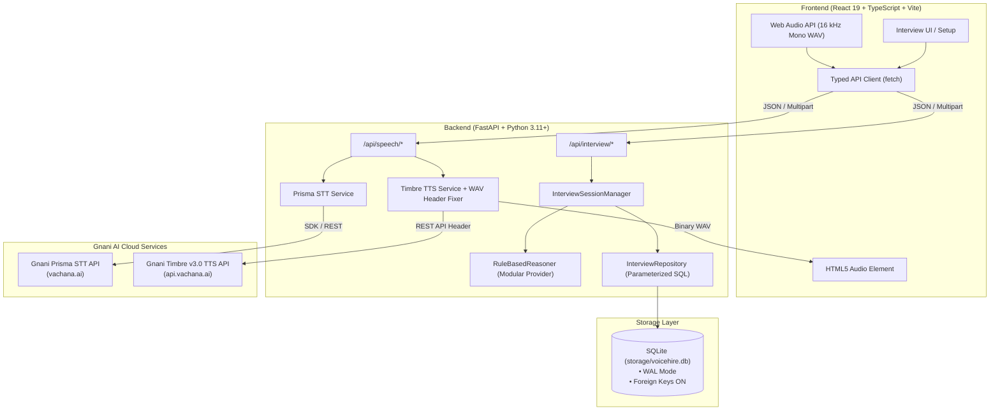
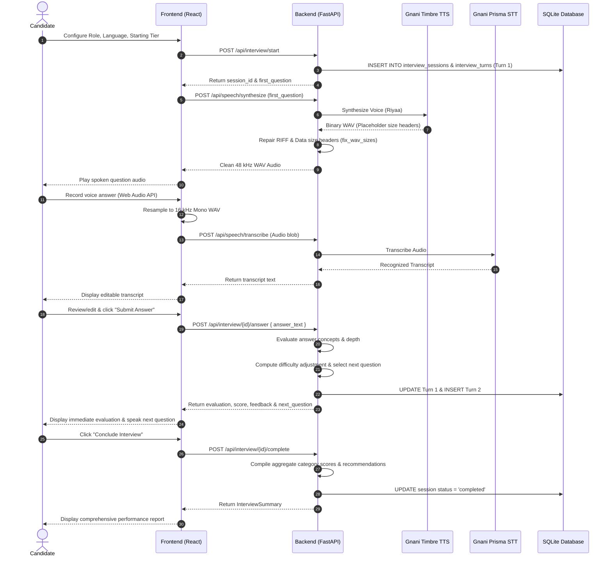
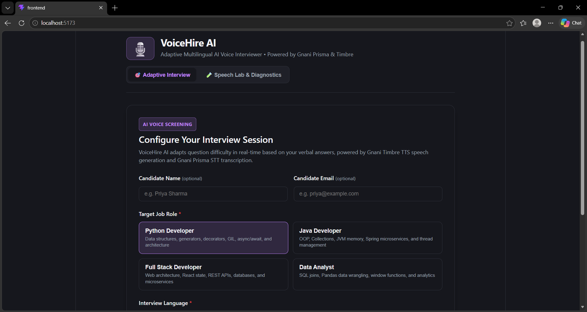
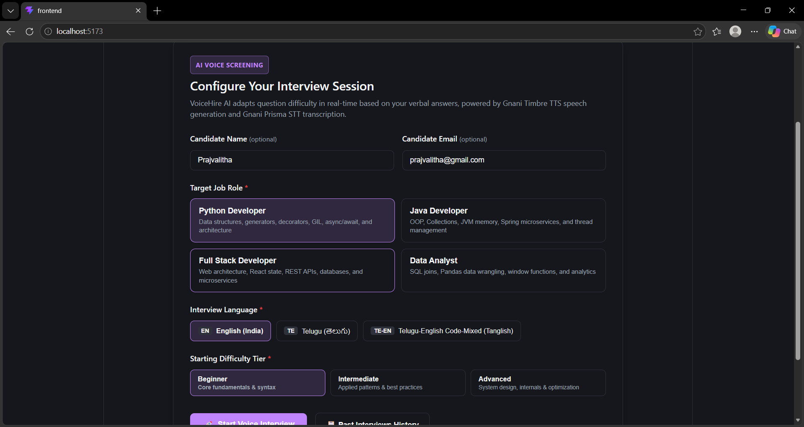
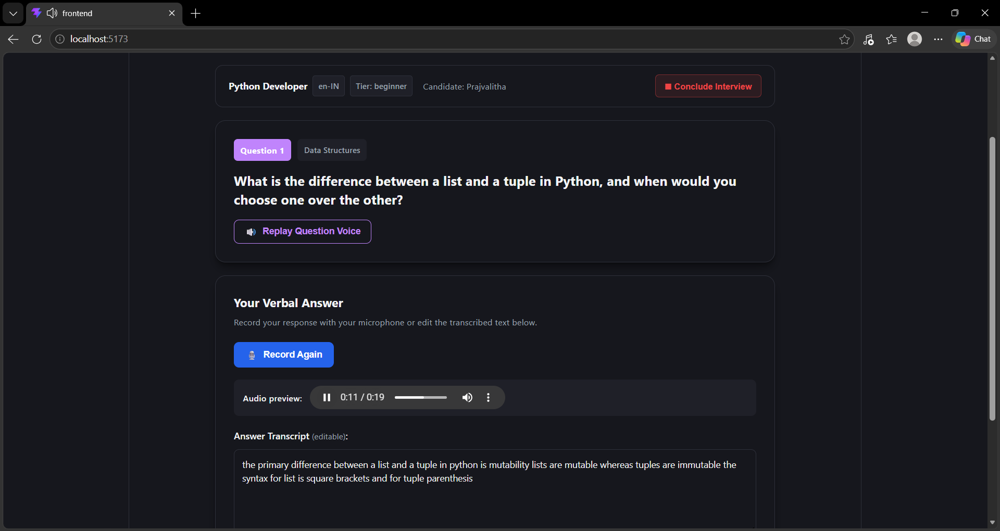
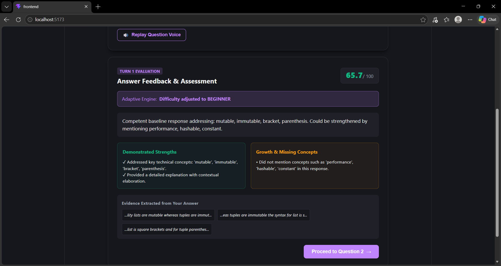
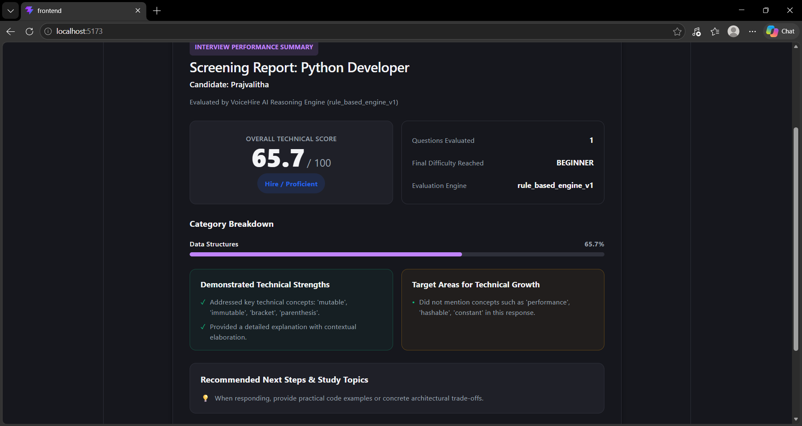
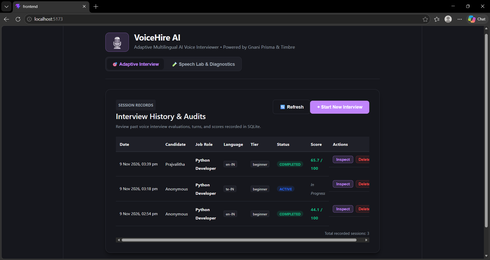
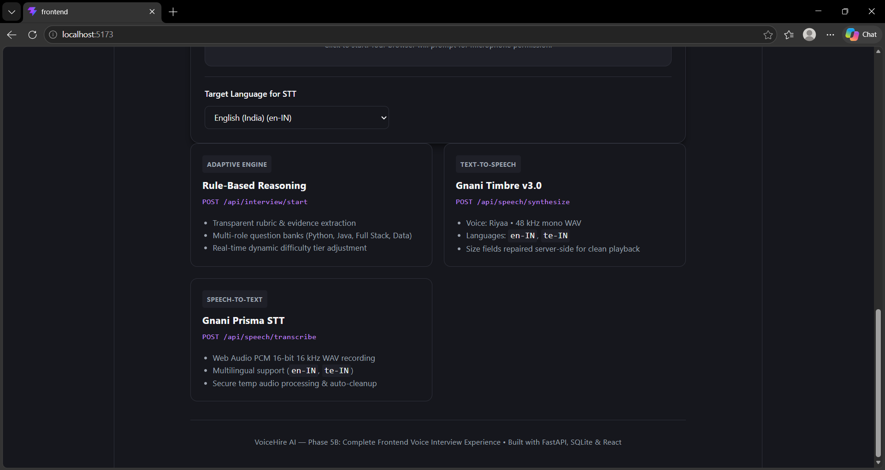

# VoiceHire AI — Your Personal Adaptive AI Interviewer

[](#9-automated-test-suite--verification)
[](#9-automated-test-suite--verification)
[](https://fastapi.tiangolo.com)
[](https://react.dev)
[](https://www.typescriptlang.org)
[](https://vite.dev)
[-003B57.svg?logo=sqlite&logoColor=white)](https://sqlite.org)
[](https://gnani.ai)

> **Built for the Gnani AI Great Indian AI Internship Challenge**
> An adaptive, voice-first technical interview screening platform that listens to candidate answers, evaluates technical depth with transparent evidence-based scoring, dynamically scales question difficulty, and supports interview workflows in **English (`en-IN`)**, **Telugu (`te-IN`)**, and **Telugu-English Code-Mixed (`te-en`)**.

---

## 📋 Table of Contents

1. [Project Overview & Problem Statement](#1-project-overview--problem-statement)
2. [Key Features](#2-key-features)
3. [Language & Code-Mixed Support Matrix](#3-language--code-mixed-support-matrix)
4. [Architecture & Request Flow](#4-architecture--request-flow)
5. [Technology Stack](#5-technology-stack)
6. [Project Folder Structure](#6-project-folder-structure)
7. [Windows Installation & Local Setup](#7-windows-installation--local-setup)
8. [Environment Configuration](#8-environment-configuration)
9. [Running the Application](#9-running-the-application)
10. [Automated Test Suite & Verification](#10-automated-test-suite--verification)
11. [Current Limitations & Honest Disclosures](#11-current-limitations--honest-disclosures)
12. [Application Screenshots](#12-application-screenshots)
13. [Demo Video](#13-demo-video)
14. [Future Roadmap](#14-future-roadmap)

---

## 1. Project Overview & Problem Statement

### The Problem
Traditional technical screening interviews face critical bottlenecks:
- **Language Barriers:** Most automated screeners mandate rigid, formal English. Candidates who think natively in Indian languages or conversational code-mixed dialects (like Tanglish) struggle to convey deep conceptual knowledge.
- **Static Question Scripts:** Fixed question sequences fail to challenge experienced candidates and unnecessarily discourage junior developers without adapting to proven competency.
- **Opaque Scoring:** Evaluators often produce arbitrary scores without actionable justifications or verbatim evidence from candidate answers.
- **Engineering Overhead:** Technical staff spend hundreds of hours conducting initial phone screens instead of building core product features.

### The Solution: VoiceHire AI
**VoiceHire AI** provides an adaptive, voice-driven technical interview screening experience powered by **Gnani AI's voice infrastructure**:
1. **Speaks Questions Natively:** Questions are synthesized into natural spoken audio via **Gnani Timbre v3.0 Text-to-Speech**.
2. **Captures Voice in the Browser:** Built-in Web Audio API records candidate answers as 16 kHz mono PCM audio without external client-side recording dependencies.
3. **Transcribes with Prisma STT:** Candidate voice audio is transcribed via **Gnani Prisma Speech-to-Text**, with an editable review interface before submission.
4. **Adapts Dynamically:** A modular reasoning engine analyzes the transcript against a transparent technical rubric, adjusting subsequent question difficulty (**Beginner ➔ Intermediate ➔ Advanced**) in real time.
5. **Audits Persistently:** All sessions, questions, transcripts, scores, and feedback turns are stored in a local **SQLite** database, generating comprehensive scorecards with actionable study recommendations.

---

## 2. Key Features

- 🎙️ **In-Browser Web Audio Recording:** Zero-external-dependency microphone pipeline using the browser's native Web Audio API. Captures audio, downsamples to 16,000 Hz, and generates standard 16-bit mono PCM WAV blobs with valid RIFF headers.
- 🗣️ **Gnani Timbre v3.0 Speech Synthesis:** Generates 48 kHz mono spoken audio (`Riyaa` voice). Implements a server-side WAV header repair utility that patches Gnani's `0xFFFFFFFF` placeholder chunk size fields to ensure uninterrupted browser playback.
- 📝 **Gnani Prisma Speech-to-Text:** Robust speech recognition supporting Indian English (`en-IN`) and Telugu (`te-IN`). Transcribed text is populated into an editable textarea so candidates can verify technical terminology before submitting.
- 📈 **Dynamic Adaptive Difficulty Scaling:** Scores keyword coverage, architectural depth, and technical relevance. Automatically upgrades difficulty on strong answers ($\ge 70\%$) or scales down on incomplete answers ($\le 40\%$).
- 📊 **Transparent Performance Scorecards:** Generates structured reports with overall scores (0–100), performance tier categorization, category breakdown progress bars, strengths with verbatim evidence quotes, and targeted study recommendations.
- 💾 **Local SQLite Persistence:** High-performance database (`storage/voicehire.db`) operating in WAL mode with cascading deletions, foreign key enforcement, and parameterized SQL queries to prevent SQL injection.
- 📋 **Session Audit History:** Complete historical dashboard allowing recruiters or candidates to review past sessions, inspect turn-by-turn question exchanges, or delete past screening records.

---

## 3. Language & Code-Mixed Support Matrix

To ensure absolute technical accuracy, VoiceHire AI distinguishes between underlying speech API capabilities and application-level interview modes:

| Feature / Mode | English (`en-IN`) | Telugu (`te-IN`) | Telugu-English Code-Mixed (`te-en` / Tanglish) |
|---|---|---|---|
| **Question Bank & Rubric** | Full question bank (Beginner, Intermediate, Advanced) | Full Telugu script question bank across all roles | Curated Romanized Telugu-English question templates |
| **Gnani Timbre v3.0 TTS** | Supported (`en-IN`, voice: `Riyaa`) | Supported (`te-IN`, voice: `Riyaa`) | Synthesized via `en-IN` (speaks Romanized Tanglish phonetically) |
| **Gnani Prisma STT** | Supported (`en-IN`) | Supported (`te-IN`) | Transcribed via `en-IN` / `te-IN` + Candidate editable review |
| **Evaluation Rubric** | Evaluates English technical concepts | Evaluates Telugu script technical terms | Evaluates mixed English technical terms and Telugu phrases |

> **Accurate Disclosure on Code-Mixed Support:**
> Gnani Timbre v3.0 natively supports `en-IN` and `te-IN`. It does not offer a separate standalone `te-en` language endpoint. For code-mixed interviews, questions are authored in Romanized Telugu-English (e.g., *"Python lo list and tuple madhya differences enti?"*), synthesized through Timbre's `en-IN` model, transcribed via Prisma STT, and presented in an editable text area so candidates can correct technical keywords before evaluation.

---

## 4. Architecture & Request Flow

### System Architecture Diagram



### Complete Interview Turn Sequence



---

## 5. Technology Stack

| Layer | Technology | Exact Version | Purpose |
|---|---|---|---|
| **Frontend Framework** | React | 19.3.1 | Component-based interactive UI |
| **Language** | TypeScript | 6.0.3 | Strict end-to-end type safety |
| **Bundler & Dev Server** | Vite | 8.3.6 | Fast HMR and production bundle optimization |
| **Audio Processing** | Web Audio API | Native Browser | In-browser 16 kHz mono WAV recording & resampling |
| **Backend Framework** | FastAPI | 0.162.2 | High-performance asynchronous REST API |
| **Language Runtime** | Python | 3.11+ / 3.14 | Modern backend server environment |
| **Database** | SQLite3 | Native Built-in | Zero-dependency ACID persistent storage with WAL mode |
| **Speech-to-Text** | Gnani Prisma STT | `gnani-vachana` 0.9.0 | Indic speech recognition (`en-IN`, `te-IN`) |
| **Text-to-Speech** | Gnani Timbre v3.0 | REST API | 48 kHz voice synthesis (`Riyaa` voice, `en-IN`, `te-IN`) |
| **Reasoning Engine** | Modular Rule-Based | Custom | Deterministic rubric evaluation with evidence extraction |
| **Testing (Backend)** | Pytest | 9.2.0 | Automated unit and integration testing (133 tests) |
| **Testing (Frontend)** | Node Test Runner | Node 20+ Native | Fast TypeScript unit testing (30 tests) |
| **Linting & Code Style** | ESLint | 10.14.0 | React 19 and TypeScript static code analysis |

---

## 6. Project Folder Structure

```
VoiceHireAI/
├── .gitignore                     # Git ignore rules (secrets, audio, storage/voicehire.db)
├── README.md                      # Comprehensive project documentation
├── docs/                          # Project documentation and visual walkthrough assets
│   └── assets/                    # Application screenshots (01-home.png to 07-speech-lab.png)
├── storage/                       # SQLite storage directory (auto-created on startup)
│   └── voicehire.db               # SQLite database file (gitignored)
│
├── backend/                       # FastAPI Backend Application
│   ├── .env.example               # Template for backend environment variables
│   ├── requirements.txt           # Python backend dependencies (fastapi==0.162.2, etc.)
│   ├── app/
│   │   ├── main.py                # FastAPI entry point, CORS & router registration
│   │   ├── api/
│   │   │   ├── routes.py          # Health check (/health) and welcome (/) routes
│   │   │   ├── speech.py          # Gnani Prisma STT & Timbre TTS proxy endpoints
│   │   │   └── interview.py       # 6 Adaptive Interview Engine REST endpoints
│   │   ├── core/
│   │   │   └── config.py          # Application settings & environment loader
│   │   ├── db/
│   │   │   ├── database.py        # SQLite connection factory, WAL mode & schema setup
│   │   │   └── repository.py      # Parameterized SQL queries for sessions & turns
│   │   ├── models/
│   │   │   └── interview.py       # Pydantic v2 domain schemas, enums & validators
│   │   └── services/
│   │       ├── interview_service.py # InterviewSessionManager lifecycle coordinator
│   │       ├── stt_service.py     # Gnani Prisma STT transcription handler
│   │       ├── tts_service.py     # Gnani Timbre TTS client & WAV header size patcher
│   │       └── reasoning/
│   │           ├── base.py        # Abstract BaseReasoningProvider interface
│   │           └── rule_based.py  # Transparent deterministic rubric evaluation engine
│   └── tests/                     # 133 Automated Backend Tests
│       ├── test_health.py         # Health endpoint & OpenAPI validation
│       ├── test_stt.py            # Prisma STT service & endpoint unit tests
│       ├── test_tts.py            # Timbre TTS, WAV header repair & endpoint tests
│       ├── test_interview_models.py # Pydantic schema validation & score bounds tests
│       ├── test_reasoning_rule_based.py # Reasoning engine, question bank & rubric tests
│       ├── test_interview_db.py   # SQLite tables, WAL, indexes & SQL injection tests
│       ├── test_interview_service.py # Session state machine & lifecycle tests
│       └── test_interview_api.py  # FastAPI interview endpoint integration tests
│
└── frontend/                      # React + TypeScript + Vite Application
    ├── .env.example               # Template for frontend environment variables
    ├── package.json               # Frontend dependencies & npm test scripts
    ├── tsconfig.json              # TypeScript strict configuration
    ├── vite.config.ts             # Vite build configuration
    └── src/
        ├── main.tsx               # React application entry point
        ├── App.tsx                # Top-level tabs & session state management
        ├── App.css                # Polished responsive styling, modals & animations
        ├── index.css              # Typography & CSS variable theme tokens
        ├── components/
        │   ├── BackendStatus.tsx  # Live backend connectivity pill
        │   ├── AudioTranscribe.tsx # Prisma STT testing playground component
        │   ├── InterviewQuestionSpeaker.tsx # Timbre TTS testing playground component
        │   └── interview/         # Adaptive Interview Components
        │       ├── InterviewSetup.tsx     # Role, language & difficulty configuration
        │       ├── InterviewRoom.tsx      # Spoken questions, recording, STT & submission
        │       ├── InterviewReport.tsx    # Final performance report & recommendations
        │       ├── InterviewHistory.tsx   # SQLite session audit table & turn inspect
        │       └── interviewWorkflow.test.ts # Workflow, mapper & tier unit tests
        ├── hooks/
        │   └── useAudioRecorder.ts # Web Audio recording, resampling & WAV encoding hook
        ├── services/
        │   ├── api.ts             # Typed API client for speech & interview endpoints
        │   └── api.test.ts        # Unit tests for interview API client functions
        └── utils/
            ├── audioUtils.ts      # Audio resampling, duration format & WAV encoding
            ├── audioUtils.test.ts # WAV generation & math unit tests
            └── audioRecorder.test.ts # Web Audio mock & cleanup tests
```

---

## 7. Windows Installation & Local Setup

### Prerequisites
- **Operating System:** Windows 10 or Windows 11 (64-bit)
- **Python:** Python 3.11+ (Python 3.14 tested and verified)
- **Node.js:** Node.js 20+ (Node.js 24 tested and verified) with `npm`
- **Git:** Git for Windows
- **Gnani AI Account:** Active `GNANI_API_KEY` for Prisma STT and Timbre TTS

### Step 1: Clone the Repository
Open PowerShell:
```powershell
git clone https://github.com/your-username/VoiceHireAI.git
cd VoiceHireAI
```

### Step 2: Set Up Backend Virtual Environment
```powershell
# Create Python virtual environment
python -m venv .venv

# Activate the virtual environment
.\.venv\Scripts\Activate.ps1

# Upgrade pip and install backend dependencies
python -m pip install --upgrade pip
pip install -r backend/requirements.txt
```

### Step 3: Install Frontend Dependencies
```powershell
# Navigate to frontend and install packages
cd frontend
npm install
cd ..
```

---

## 8. Environment Configuration

### Backend Configuration (`backend/.env`)
VoiceHire AI isolates all API keys on the server. The frontend never accesses or handles secret tokens.

1. Verify `backend/.env.example` exists:
   ```ini
   # VoiceHire AI Backend Configuration
   # Replace with your actual Gnani API Key (keep secret, never commit real .env to git)
   GNANI_API_KEY=your_gnani_api_key_here
   ```
2. Create `backend/.env`:
   ```powershell
   Copy-Item backend/.env.example backend/.env
   ```
3. Edit `backend/.env` with your actual Gnani API key:
   ```ini
   GNANI_API_KEY=your_actual_gnani_api_key_here
   ```

### Frontend Configuration (`frontend/.env`)
1. Verify `frontend/.env.example` exists:
   ```ini
   VITE_API_BASE_URL=http://127.0.0.1:8000
   ```
2. Create `frontend/.env`:
   ```powershell
   Copy-Item frontend/.env.example frontend/.env
   ```

---

## 9. Running the Application

### 1. Start the FastAPI Backend
In your first PowerShell window (with `.venv` activated):
```powershell
.\.venv\Scripts\python.exe -m uvicorn app.main:app --app-dir backend --reload --host 127.0.0.1 --port 8000
```
- **Backend Base URL:** `http://127.0.0.1:8000`
- **Swagger API Documentation:** `http://127.0.0.1:8000/docs`
- **Health Check Endpoint:** `http://127.0.0.1:8000/health`

### 2. Start the React Frontend
In a second PowerShell window:
```powershell
cd frontend
npm run dev
```
- **Frontend Application:** `http://localhost:5173`

Open `http://localhost:5173` in any modern browser, grant microphone access when prompted, and start your interview!

---

## 10. Automated Test Suite & Verification

The project includes automated test coverage across both the backend and frontend.

### Backend Tests (133 passed in ~2.0s)
Execute the complete backend test suite:
```powershell
.\.venv\Scripts\python.exe -m pytest backend/tests -v
```

**Coverage Breakdown:**
- `test_health.py`: 5 tests verifying OpenAPI paths, health payload, and CORS middleware.
- `test_stt.py`: 14 tests verifying Prisma STT language options, audio payloads, and provider error codes.
- `test_tts.py`: 54 tests verifying Timbre TTS API calls, WAV RIFF/data size header repair, PCM format preservation, and duration calculation.
- `test_interview_models.py`: 15 tests verifying Pydantic models, difficulty enums, language codes, and score boundary validations.
- `test_reasoning_rule_based.py`: 21 tests verifying multi-role question generation, evidence extraction, keyword rubric matching, and summary reports.
- `test_interview_db.py`: 9 tests verifying SQLite schema creation, WAL journal mode, indexes, session/turn CRUD, cascading deletions, and SQL injection resistance.
- `test_interview_service.py`: 6 tests verifying `InterviewSessionManager` turn progression, score tracking, 404/400 domain errors, and completion summaries.
- `test_interview_api.py`: 9 tests verifying FastAPI `/api/interview/*` endpoints, JSON responses, and HTTP status code mappings.

```
============================= 133 passed in 2.03s =============================
```

### Frontend Tests (30 passed in ~230ms)
Execute the frontend test suite:
```powershell
cd frontend
npm test
```

**Coverage Breakdown:**
- `audioUtils.test.ts`: 10 tests verifying 44.1/48 kHz to 16 kHz audio buffer downsampling, Float32 merging, duration formatting, and PCM 16-bit WAV header generation.
- `audioRecorder.test.ts`: 3 tests verifying browser Web Audio API support detection, track cleanup on stop/unmount, and DOMException mapping.
- `api.test.ts`: 8 tests verifying all interview API functions (`startInterview`, `submitAnswer`, `getInterviewSession`, `completeInterview`, `listInterviews`, `deleteInterview`), payload serialization, and structured error handling.
- `interviewWorkflow.test.ts`: 9 tests verifying role options, language mappers (TTS/STT), answer validation, turn state progression, and report scoring tiers.

```
ℹ tests 30, pass 30, fail 0 (duration: 229ms)
```

### ESLint & Production Build
```powershell
cd frontend
npm run lint    # 0 errors, 0 warnings
npm run build   # tsc -b && vite build (built in ~150ms)
```

---

## 11. Current Limitations & Honest Disclosures

To maintain absolute academic and engineering integrity for the Gnani AI submission:

1. **Reasoning Engine Implementation:** The reasoning layer is currently powered by `RuleBasedReasoner`, a deterministic rubric-based engine that evaluates keyword coverage, technical depth, and answer length. It extracts verbatim textual evidence without hallucinations.
2. **Gnani Evon Integration Status:** **Gnani Evon is not yet integrated.** The abstract `BaseReasoningProvider` interface is established to decouple reasoning from the session manager, ensuring that when Gnani Evon API access is granted, it can be integrated as a drop-in provider without rewriting application logic.
3. **No Heavy Local Models:** In accordance with challenge rules, no heavy 30B model is downloaded or executed locally.
4. **Speech Synthesis vs Translation:** Gnani Timbre v3.0 renders whatever text is passed to it; it is a high-fidelity speech synthesizer, not an automatic language translator. For Telugu questions, prompts are rendered from our curated Telugu and code-mixed banks.
5. **Browser Autoplay Policies:** Browsers enforce strict autoplay prevention rules for audio. If the browser restricts automatic question playback on turn advance, candidates can click the **"Speak Question Voice"** button.

---

## 12. Application Screenshots

### 1. Adaptive Interview Home

*Welcome view of VoiceHire AI showing the adaptive interview mode, quick-start configuration, and navigation tabs.*

---

### 2. Interview Configuration & Role Selection

*Candidate setup interface supporting technical role selection (Python, Java, Full Stack, Data Analyst), language modes (English, Telugu, Code-Mixed), and starting difficulty tiers.*

---

### 3. Live Adaptive Interview Room

*Live interview room with spoken question playback via Gnani Timbre v3.0, browser Web Audio recording with live duration timer, and editable transcript area.*

---

### 4. Answer Evaluation & Real-Time Difficulty Adjustment

*Turn-by-turn transparent evaluation card showing score, real-time difficulty tier adjustment, constructive feedback, demonstrated strengths, missing concepts, and verbatim evidence quotes.*

---

### 5. Final Interview Performance Report

*Structured candidate performance scorecard featuring overall score, performance tier badge, category breakdown progress bars, summary strengths, and targeted study recommendations.*

---

### 6. Interview History & Session Audit

*Persistent SQLite session audit log showing historical candidate screening records, completion status, overall scores, and turn inspection modal.*

---

### 7. Speech Lab & Gnani Integration Diagnostics

*Dedicated Speech Lab diagnostic playground for verifying isolated Gnani Timbre v3.0 text-to-speech synthesis and Gnani Prisma speech-to-text audio transcription.*

---

## 13. Demo Video

> **Walkthrough Video Placeholder**
>
> [](https://www.youtube.com/watch?v=placeholder)
>
> *A full video demonstration showcasing setup, spoken question synthesis, live microphone answering, Prisma transcription, real-time difficulty adaptation, and performance scorecard generation will be linked here.*

---

## 14. Future Roadmap

1. **Gnani Evon API Integration:** Connect `BaseReasoningProvider` directly to the Gnani Evon API once early access credentials are granted, enabling open-domain reasoning and nuanced coding critiques.
2. **Full-Duplex Conversational Audio:** Transition from turn-based request-response audio to streaming WebSockets for natural interruptions and real-time conversational pacing.
3. **Expanded Indic Language Suite:** Expand question templates, TTS voices, and STT pipelines to include Hindi (`hi-IN`), Tamil (`ta-IN`), Kannada (`kn-IN`), and Bengali (`bn-IN`).
4. **Behavioral & Non-Verbal Signals:** Analyze speaking cadence, hesitation pauses, and structural clarity as supplementary soft-skills indicators.
5. **Enterprise ATS Webhooks:** Enable one-click export of structured interview evaluation reports to platforms like Greenhouse, Lever, and Workday.

---

## 📄 License & Acknowledgments

- **Developed for:** Gnani AI Great Indian AI Internship Challenge
- **Speech Technologies:** Powered by [Gnani.ai](https://gnani.ai) (Gnani Prisma STT & Gnani Timbre v3.0 TTS)
- **License:** MIT License
